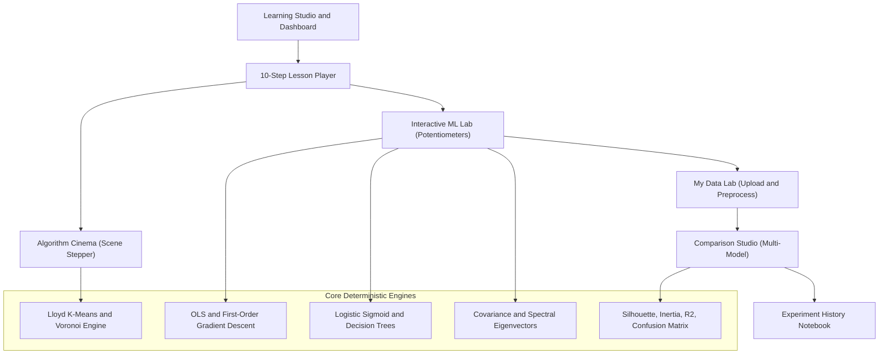

# ML in Motion
### Adaptive, Interactive Machine Learning Laboratory & Visual Textbook

> **Aesthetic Philosophy: Analog Bauhaus (Analog Lab)**  
> Treats the digital interface as a physical, benchtop computing instrument. Hard-edge zero-blur elevation (`3px 3px 0px #1A1715`), tactile insets, Bauhaus semantic primaries (Ultramarine, Vermilion, Cadmium Yellow, Sage Green), mechanical tape counters, and synchronized mathematical-to-visual bridges.

---

## 1. System Vision & Architecture

ML in Motion bridges the journey:
$$\text{Intuition} \longrightarrow \text{Visualization} \longrightarrow \text{Experimentation} \longrightarrow \text{Mathematical Derivation} \longrightarrow \text{Implementation} \longrightarrow \text{Mastery}$$

Instead of passive slide decks or toy animations, every visual state is driven by genuine mathematical simulations executed deterministically client-side with full execution traces.



---

## 2. Implemented Modules

### 0. Visual Concept Cards System
- **Reusable 7-Card Explanatory Structure** for every machine learning concept:
  1. **Concept in a Nutshell:** Simple intuition, why it exists, problem solved, primary formula plate, and inductive traits.
  2. **How Does It Work:** 3–5 numbered mechanical pipeline steps with LaTeX equations and step tags.
  3. **Visual Worked Example:** Relatable scenario, inputs/outputs breakdown, and **embedded interactive live simulation bench** with genuine mathematical calculations (OLS residual bench, Gradient descent loss bowl, Lloyd Voronoi clustering, Sigmoid thresholding, Decision tree Gini split optimizer, PCA orthogonal variance projection, Ensemble Condorcet majority voting bench).
  4. **Types / Methods / Variants:** Comparative breakdown with semantic badge tags and ideal use cases.
  5. **Real-Life Implementation:** Realistic scenarios, inputs/outputs/hyperparameter specifications, and copyable Python/scikit-learn code readers.
  6. **Advantages, Limitations & Pathologies:** Strengths, bottlenecks, fundamental assumptions, and failure modes with concrete symptoms and remedies.
  7. **Key Takeaways, Misconceptions & Active Recall:** Summary points, myth-vs-reality callout, interactive multiple-choice recall question with immediate validation, and direct pathways to the Interactive Lab and Cinema.
- **Central Concept Registry & Archival Cards Hub (`/concepts`):** Search, category filtering, difficulty badges, bookmarks, and local progress tracking.
- **Complete Phase-1 Concepts:** Linear Regression, Gradient Descent, K-Means Clustering, Logistic Regression, Decision Trees, Principal Component Analysis (PCA), and Ensemble Learning.

### 1. Algorithm Cinema
- Scene-by-scene visual storytelling for K-Means clustering.
- Tape Counter playhead with monospaced tabular numerals, stepped speeds, and physical mechanical toggle blocks.
- Historical centroid pen trajectory ($\mu^{(0)}, \dots, \mu^{(t)}$).
- Synchronized NumPy execution kernel highlighting corresponding active code lines.

### 2. Interactive ML Lab
- **Linear Regression & OLS:** 2D canvas with draggable coordinates, noise lever ($\sigma$), closed-form OLS vs manual lever, residual error bars in Vermilion (`#C83226`).
- **Gradient Descent:** Dynamic step optimizer with adjustable learning rate ($\alpha$), loss curve trajectory, oscillation and divergence detection.
- **Logistic Regression & Thresholds:** Sigmoid log-odds curve, probability cutoff slider ($\tau$), dynamic 2x2 confusion matrix (TP, FP, TN, FN), and F1 metrics.
- **Decision Trees:** Orthogonal axis partitions, candidate Gini impurity calculation, depth regularization.
- **PCA:** 2D data centering, covariance matrix, spectral eigenvector projection, explained variance ratio.

### 3. My Data Lab
- CSV file uploader and built-in benchmark datasets (Fisher Iris, Student Performance).
- **Data Quality Assistant:** Automated diagnostic scanning for missing values, constant features, extreme outliers ($1.5 \times \text{IQR}$), and class imbalance.
- **Preprocessing Studio:** Numerical scaling (`StandardScaler`, `MinMaxScaler`), missing value imputation (`mean`, `drop`), and train/test partition control.

### 4. Algorithm Comparison Studio
- **"Same Dataset, Different Algorithms":** Side-by-side execution of K-Means, DBSCAN, and Agglomerative Hierarchical Clustering on identical data splits.
- Benchmark geometries: Separated Spherical Blobs, Concentric Rings (topological failure case), and Anisotropic Bands.
- Quantitative evaluation metrics: Silhouette score, noise count, runtime.
- Scientific explanations of geometric inductive bias and the "No Universal Winner" principle.

### 5. Adaptive Learning Engine & Concept DAG
- Explicit prerequisite graph with progression gates.
- Misconception detector mapping flawed reasoning to targeted diagnostic remediation cards.
- Deterministic recommendation engine explaining *why* an activity was prescribed.
- Spaced repetition queue and persistent guest state storage.

### 6. Personal Experiment Notebook
- Saved runs containing dataset fingerprints, hyperparameters, evaluation metrics, and runtime.
- Exportable audit log (JSON).

---

## 3. Technology Stack

- **Framework:** Next.js 14 (App Router, TypeScript)
- **Styling:** Tailwind CSS (configured with the Analog Bauhaus token matrix)
- **Math Engine:** KaTeX for mathematical notation
- **Icons:** Lucide React (mechanical line styling)
- **State & Physics:** React Hooks, LocalStorage, Framer Motion springs

---

## 4. Getting Started

### Installation
```bash
npm install
```

### Development Server
```bash
npm run dev
```
Navigate to `http://localhost:3000` in your browser.

### Production Build
```bash
npm run build
npm run start
```
