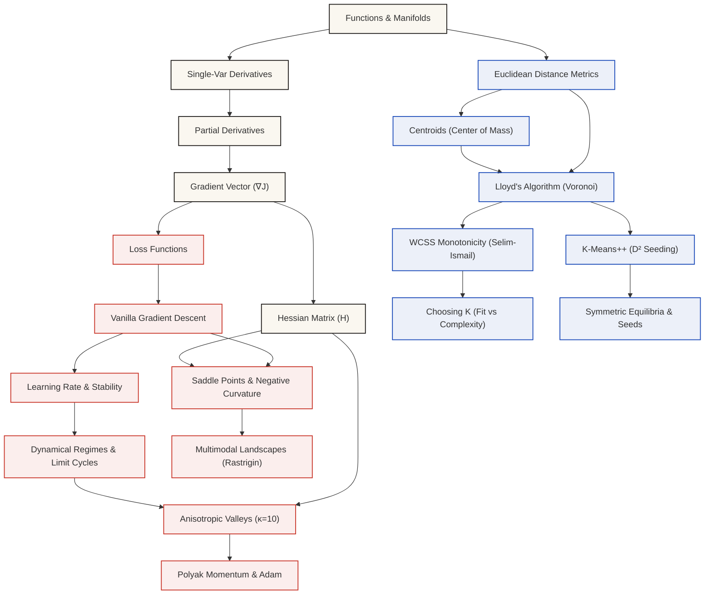

# Concept Knowledge Graph & Prerequisite Dependency Architecture

**Phase:** Phase 07 — Structured Learning Paths & Concept Mastery  
**Status:** IMPLEMENTED & AUDITED  
**Date:** November 2026  
**Implementation:** [`src/lib/learning/concepts/`](file:///d:/Projects/ML%20in%20Motion/src/lib/learning/concepts/)  
**Associated Automated Tests:** 17/17 Passing ([`scripts/test-phase-07-mastery.mjs`](file:///d:/Projects/ML%20in%20Motion/scripts/test-phase-07-mastery.mjs))

---

## 1. Mathematical Formalism

The ML in Motion knowledge graph is formalized as a finite Directed Acyclic Graph (DAG):
$$G = (V, E)$$
where:
- $V = \{c_1, c_2, \dots, c_n\}$ represents the set of discrete machine learning concepts.
- $E \subset V \times V$ represents the set of directed prerequisite dependencies. An edge $(u, v) \in E$ denotes that concept $u$ is a strict mathematical prerequisite for concept $v$ ($u \prec v$).

A valid learning sequence corresponds to a topological sort of $G$:
$$\tau: V \to \{1, 2, \dots, |V|\} \quad \text{such that} \quad (u, v) \in E \implies \tau(u) < \tau(v)$$



---

## 2. Concept Schema Definition

Every concept in the repository is strictly typed via `ConceptNode`:

```typescript
export interface ConceptNode {
  id: string;
  name: string;
  subject: 'mathematics' | 'optimization' | 'clustering' | 'foundations' | 'data-engineering';
  difficulty: 'foundational' | 'intermediate' | 'advanced';
  summary: string;
  prerequisites: string[]; // Direct ancestor IDs in DAG
  learningObjectives: string[];
  relatedSimulationUrl?: string; // Direct link to workbench
  relatedChallenges: string[]; // Break-the-algorithm challenge IDs
  relatedPracticeQuestionIds: string[]; // Linked assessment questions
  completionCriteria: {
    minPredictions: number;
    minAccuracy: number;
    requiredChallengeIds: string[];
    minPracticePassed: number;
  };
  isImplemented: boolean;
}
```

---

## 3. Curated Concept Nodes (Phase 07 Baseline)

### 3.1 Mathematical Foundations
1. **`math-functions` (Functions & Coordinate Manifolds):** Scalar mappings $f: \mathbb{R} \to \mathbb{R}$ and loss surfaces $J: \mathbb{R}^n \to \mathbb{R}$. Prereqs: $\emptyset$.
2. **`math-derivatives` (Single-Variable Derivatives):** Instantaneous rate of change and tangent approximations. Prereqs: `['math-functions']`.
3. **`math-partial-derivatives` (Multivariable Partial Derivatives):** Coordinate-wise differentiation holding other coordinates fixed. Prereqs: `['math-derivatives']`.
4. **`math-gradients` (The Gradient Vector $\nabla J$):** Direction of steepest ascent and orthogonality to level contours. Prereqs: `['math-partial-derivatives']`.
5. **`math-hessians` (The Hessian Matrix & Curvature):** Second-order partial derivatives and spectral condition number $\kappa = \lambda_{\max}/\lambda_{\min}$. Prereqs: `['math-gradients']`.

### 3.2 Optimization Algorithms (Flagship Cinema Laboratory)
6. **`opt-loss-functions` (Optimization Objectives):** Quadratic bowls, error residuals, and convex vs non-convex surfaces. Prereqs: `['math-gradients']`.
7. **`opt-gradient-descent` (Vanilla Gradient Descent):** Discrete parameter updates $\boldsymbol{\theta}_{t+1} = \boldsymbol{\theta}_t - \alpha \nabla J(\boldsymbol{\theta}_t)$. Prereqs: `['opt-loss-functions']`.
8. **`opt-learning-rate` (Learning Rate & Spectral Stability):** Contraction factor $|1 - \alpha \lambda|$ and critical threshold $\alpha_{\text{crit}} = 2/\lambda_{\max}$. Prereqs: `['opt-gradient-descent']`.
9. **`opt-convergence-regimes` (Dynamical Regimes & Limit Cycles):** Monotonic, deadbeat ($\alpha=1$), oscillatory ($1<\alpha<2$), conservative limit cycles ($\alpha=2$), and geometric divergence ($\alpha>2$). Prereqs: `['opt-learning-rate']`.
10. **`opt-anisotropic-valleys` (Ill-Conditioned Ravines):** Anisotropic Hessians ($\kappa = 10$) where steep vertical axes diverge while shallow horizontal axes contract. Prereqs: `['opt-convergence-regimes', 'math-hessians']`.
11. **`opt-saddle-points` (Saddle Points & Negative Curvature):** First-order necessary condition ($\nabla J = \mathbf{0}$) vs indefinite Hessian ($\lambda_1 < 0 < \lambda_2$). Prereqs: `['math-hessians', 'opt-gradient-descent']`.
12. **`opt-momentum-adam` (Polyak Momentum & Adam):** Heavy-ball velocity damping and coordinate-wise adaptive moment scaling. Prereqs: `['opt-anisotropic-valleys']`.
13. **`opt-multimodal-landscapes` (Multimodal Landscapes):** Rastrigin function, local basins of attraction, and initialization sensitivity. Prereqs: `['opt-saddle-points']`.

### 3.3 Clustering & Unsupervised Learning (Flagship Cinema Laboratory)
14. **`clust-distance-metrics` (Euclidean Distance & Isotropy):** Squared Euclidean metric $d(\mathbf{x}, \boldsymbol{\mu})^2$ and feature standardization requirements. Prereqs: `['math-functions']`.
15. **`clust-centroids` (Centroids & Centers of Mass):** Arithmetic mean $\boldsymbol{\mu}_k = \frac{1}{|S_k|}\sum \mathbf{x}$ as closed-form WCSS minimizer. Prereqs: `['clust-distance-metrics']`.
16. **`clust-kmeans-lloyd` (Lloyd's K-Means Algorithm):** Alternating Voronoi point assignment and centroid relocation. Prereqs: `['clust-centroids', 'clust-distance-metrics']`.
17. **`clust-wcss-monotonicity` (Selim-Ismail Two-Stage Monotonicity):** Proof of non-increasing WCSS across both sub-stages:
    $$J(c^{(t+1)}, \boldsymbol{\mu}^{(t+1)}) \le J(c^{(t+1)}, \boldsymbol{\mu}^{(t)}) \le J(c^{(t)}, \boldsymbol{\mu}^{(t)})$$
    Prereqs: `['clust-kmeans-lloyd']`.
18. **`clust-kmeans-plus-plus` (K-Means++ & $D^2$ Seeding):** Expected approximation ratio $\mathbb{E}[\phi] \le 8(\ln K + 2)\phi_{\text{opt}}$ (Arthur & Vassilvitskii, 2007). Prereqs: `['clust-kmeans-lloyd']`.
19. **`clust-model-complexity` (Choosing K: Fit vs Complexity):** Monotonicity of optimal WCSS with $K$ ($\min_{\boldsymbol{\mu}} J_K \le \min_{\boldsymbol{\mu}} J_{K-1}$) and the Elbow heuristic. Prereqs: `['clust-wcss-monotonicity']`.
20. **`clust-symmetric-equilibria` (Partition Landscapes & Seeds):** Stirling numbers of the second kind $S(N, K)$, local equilibria, and seed sensitivity. Prereqs: `['clust-kmeans-plus-plus']`.

---

## 4. Graph Validation & Cycle Detection

The graph validator ([`graphValidator.ts`](file:///d:/Projects/ML%20in%20Motion/src/lib/learning/concepts/graphValidator.ts)) mathematically enforces DAG properties:
- **Depth-First Search (DFS) Cycle Detection:** Traverses the graph maintaining active recursion stacks. If any back-edge $(u, v)$ with $v \in \text{recursionStack}$ is detected, the full cycle path is extracted and reported.
- **Topological Sorting:** Computes the complete linear prerequisite order.
- **Transitive Closure:** Resolves all direct and indirect ancestors of any concept node.
- **Automated Verification:** Verified with 0 cycles in `TC-P7-01` and validated with synthetic cycle injection in `TC-P7-03`.
