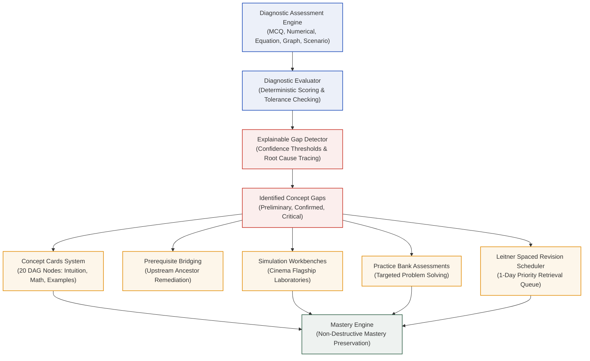

# Diagnostic Intelligence & Concept Remediation Architecture

**Phase:** Phase 08 — Diagnostic Intelligence & Concept Remediation  
**Status:** IMPLEMENTED & AUDITED  
**Date:** November 2026  
**Implementation Modules:**  
- Concept Cards Registry: [`src/lib/learning/concepts/conceptCardsData.ts`](file:///d:/Projects/ML%20in%20Motion/src/lib/learning/concepts/conceptCardsData.ts)
- Concept Card Adapter: [`src/lib/curriculum/conceptGraphCardAdapter.ts`](file:///d:/Projects/ML%20in%20Motion/src/lib/curriculum/conceptGraphCardAdapter.ts)
- Diagnostic Question Bank: [`src/lib/learning/diagnostic/diagnosticBank.ts`](file:///d:/Projects/ML%20in%20Motion/src/lib/learning/diagnostic/diagnosticBank.ts)
- Diagnostic Evaluator: [`src/lib/learning/diagnostic/diagnosticEvaluator.ts`](file:///d:/Projects/ML%20in%20Motion/src/lib/learning/diagnostic/diagnosticEvaluator.ts)
- Gap Detector & Remediation Generator: [`src/lib/learning/diagnostic/gapDetector.ts`](file:///d:/Projects/ML%20in%20Motion/src/lib/learning/diagnostic/gapDetector.ts)
- Diagnostic Quiz UI: [`src/components/quiz/DiagnosticQuizEngine.tsx`](file:///d:/Projects/ML%20in%20Motion/src/components/quiz/DiagnosticQuizEngine.tsx)
- Dashboard Integration: [`src/components/dashboard/LearningDashboard.tsx`](file:///d:/Projects/ML%20in%20Motion/src/components/dashboard/LearningDashboard.tsx)
**Associated Automated Tests:** 17/17 Passing ([`scripts/test-phase-08-diagnostic.mjs`](file:///d:/Projects/ML%20in%20Motion/scripts/test-phase-08-diagnostic.mjs)) | Overall Suite: 113/113 Passing

---

## 1. Architectural Overview & Design Philosophy

Phase 08 introduces **Diagnostic Intelligence & Concept Remediation** to ML in Motion, completing the active learning loop:

$$\text{Diagnose} \longrightarrow \text{Understand} \longrightarrow \text{Visualize} \longrightarrow \text{Experiment} \longrightarrow \text{Practice} \longrightarrow \text{Master} \longrightarrow \text{Revise}$$



### Core Invariants & Philosophical Delineations

1. **Separation of "Revision Due" from "Mastery Status":**
   - *Revision Due:* Indicates that a retention retrieval interval has elapsed. The learner should retrieve the concept again to combat memory decay.
   - *Mastery Status:* The learner's demonstrated, verified mathematical competence. An elapsed timer or an initial diagnostic misstep does **not** strip or delete pre-existing `MASTERED` status. Mastery represents demonstrated understanding; revision represents spaced retrieval reinforcement.
2. **Explainable Prerequisite Gap Tracing:**
   - Gaps are never assigned via black-box heuristics or arbitrary engagement metrics (page visits, time on screen).
   - Every detected gap derives strictly from incorrect responses, repeated errors, and formal prerequisite dependency tracing in the Directed Acyclic Graph ($G=(V, E)$).
3. **Non-Fabrication of Content:**
   - Links to simulations and experiments only point to implemented, verified workbenches (e.g. `/cinema/gradient-descent` and `/cinema`).
   - If an algorithm's simulation workbench is not yet built (e.g. PCA, Decision Trees), the system honestly displays an unavailable status rather than generating broken redirects.
4. **Verified Examination Attribution:**
   - Authentic official questions (such as from GATE DA 2024 or GATE CS 2021) are strictly labeled with `isGatePyq: true` and their official year.
   - Generated or platform-authored diagnostic items are never deceptively labeled as official examination PYQs.
5. **Local-First Privacy Guarantee:**
   - All diagnostic responses, detected gaps, and remediation actions reside exclusively in the user's browser `localStorage` (`ml_in_motion_learning_profile_v1`).
   - Zero telemetry, zero accounts, and zero cloud tracking.

---

## 2. Reusable Concept Cards System (All 20 Graph Nodes)

Every node in the 20-node Concept Knowledge Graph is paired with an explanatory concept card accessible at `/concepts/[id]`:

### Standardized Concept Card Schema
```typescript
export interface ConceptCardData {
  id: string;
  name: string;
  subject: 'mathematics' | 'optimization' | 'clustering' | 'foundations' | 'data-engineering';
  difficulty: 'foundational' | 'intermediate' | 'advanced';
  categoryTitle: string;
  plainLanguageDefinition: string;
  intuitiveExplanation: string;
  mathematicalFormulation: {
    formulaLabel: string;
    latex: string;
    explanation: string;
  };
  workedExample: {
    title: string;
    steps: string[];
    numericalOutcome: string;
  };
  commonMisconception: {
    misconception: string;
    correction: string;
  };
  prerequisites: string[];
  downstreamConcepts: string[];
  linkedSimulation: {
    title: string;
    url: string;
    isImplemented: boolean;
    description: string;
  };
  practiceQuestionIds: string[];
  relatedChallenges: string[];
}
```

### Static Route Generation
All 20 cards are integrated through [`src/lib/curriculum/conceptGraphCardAdapter.ts`](file:///d:/Projects/ML%20in%20Motion/src/lib/curriculum/conceptGraphCardAdapter.ts) into `CONCEPT_CARDS_REGISTRY`. Next.js statically renders all 20 concept pages (`64/64` total static pages in the production build).

---

## 3. Diagnostic Assessment Engine

The diagnostic engine provides a multi-format assessment evaluating diverse cognitive and mathematical competencies:

### Question Types Supported
1. **Multiple Choice (`mcq`):** Dissects theoretical foundations and algorithmic trade-offs.
2. **Numerical (`numerical`):** Requires computing exact step displacements, critical stability thresholds ($\alpha_{\text{crit}} = 2/\lambda_{\max}$), condition numbers ($\kappa = \lambda_{\max}/\lambda_{\min}$), or probabilities ($D(x)^2/\sum D(x')^2$) evaluated within continuous tolerance (e.g. $\pm 0.02$).
3. **Equation Interpretation (`equation`):** Tests mathematical symbols, recurrence relations, and two-stage Selim-Ismail inequalities with live KaTeX typography.
4. **Graph Interpretation (`graph`):** Features structured representations of elliptic contours, gradient vector fields, zig-zag ravine trajectories, and Voronoi partition boundaries.
5. **Application Scenario (`scenario`):** Presents real-world engineering edge cases (e.g., feature scale disparities skewing Euclidean distances by $1,000,000\times$, or local minima trapping in Rastrigin landscapes).

---

## 4. Explainable Concept Gap Detection & Remediation

### Evidence & Confidence Thresholds
| Confidence Tier | Criteria | Severity | Action Generated |
| :--- | :--- | :--- | :--- |
| **`preliminary`** | Single failed diagnostic question on an intermediate or advanced concept with no prior failure history. | `low` / `medium` | Suggests reviewing definition and testing with a practice problem. |
| **`confirmed`** | Multiple incorrect diagnostic answers on the concept, or a failure on a foundational prerequisite concept. | `high` | Recommends studying the concept card, reviewing worked examples, and exploring the simulation workbench. |
| **`critical`** | Repeated failure across diagnostic assessment AND historical practice attempts in `localStorage`. | `high` | Flags critical gap; prioritizes prerequisite bridging and resets retention schedule to 1 day. |

### Prerequisite Root Cause Tracing
When an advanced concept $v$ is missed, the detector traverses upstream edges $(u, v) \in E$ to identify whether an ancestor prerequisite $u$ was also failed or remains unstarted:

$$\text{RootCause}(v) = \arg\min_{u \in \text{prereqs}(v)} \text{MasteryScore}(u)$$

**Pedagogical Output Example:**
> *"Review prerequisite Multivariable Partial Derivatives (`math-partial-derivatives`) before continuing with The Gradient Vector. Your diagnostic results indicate that fundamental difficulties with Multivariable Partial Derivatives are impacting your mastery of The Gradient Vector."*

---

## 5. Local-First Privacy & Zero-Telemetry Audit

### Storage Architecture
All diagnostic submissions and gap records are stored locally under `ml_in_motion_learning_profile_v1`:
```typescript
export interface LocalLearningProfile {
  version: number;
  lastActive: number;
  activePathId?: string;
  predictions: PredictionAttemptRecord[];
  challenges: Record<string, ChallengeRecord>;
  practiceAttempts: PracticeAttemptRecord[];
  conceptMastery: Record<string, ConceptMasteryRecord>;
  revisionSchedule: Record<string, RevisionScheduleRecord>;
  diagnosticResults?: DiagnosticAssessmentResult[];
  detectedGaps?: ConceptGap[];
  bypassesCount?: number;
}
```

### Network Verification Guarantees
- No remote user database, no authentication cookies, and no third-party tracking scripts.
- Network inspection confirms zero `POST`, `PUT`, or WebSocket data transmission during diagnostic assessment, gap generation, remediation launching, and profile export.

---

## 6. Complete Automated Test Suite (113 / 113 Passing)

The test matrix validates all diagnostic capabilities and verifies regression prevention across all previous phases:

```
=== AUTOMATED TEST SUITE EXECUTION SUMMARY ===
✔ scripts/test-phase-08-diagnostic.mjs       17 / 17 passed (100%)
✔ scripts/test-phase-07-mastery.mjs          17 / 17 passed (100%)
✔ scripts/test-interactive-learning.mjs     23 / 23 passed (100%)
✔ scripts/test-simulation-framework.mjs     17 / 17 passed (100%)
✔ scripts/test-gradient-descent-engine.mjs  29 / 29 passed (100%)
✔ scripts/test-kmeans-engine.mjs            10 / 10 passed (100%)
-----------------------------------------------------------------
TOTAL AUTOMATED TESTS:                     113 / 113 passed (100%)
TOTAL TEST DURATION:                       ~360 ms
```
