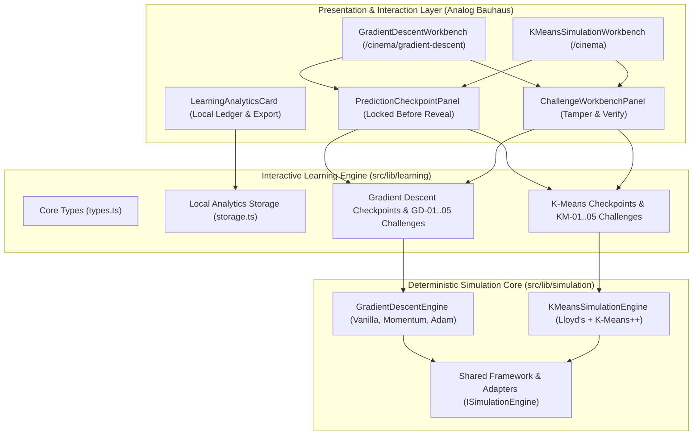

# Interactive Learning Systems — Architecture Specification (Phase 05)

## 1. Executive Summary

Phase 05 transforms **ML in Motion** from an explanatory visualization suite into a true interactive machine learning laboratory. Rather than passively watching an algorithm animate, learners engage in a structured cognitive learning loop:

1. **Observe:** Inspect current algorithm state across coordinates, matrices, and contours.
2. **Predict:** Commit to a concrete prediction (parameter update, dynamical regime, point assignment, or loss monotonicity) before execution. The engine physically locks forward stepping until the prediction is recorded.
3. **Execute:** Execute the real deterministic simulation engine step. No duplicate or synthetic math is computed in the UI.
4. **Explain:** Directly compare the learner's prediction with the engine's actual ground-truth calculation across five synchronized representations: visual glyphs, calculated numerical deltas, mathematical equation, pseudocode, and Python engine snippet.
5. **Experiment ("Break the Algorithm"):** Intentionally tamper with hyperparameters to induce, verify, and understand mathematical failure modes (spectral instability, anisotropic Hessian traps, saddle stalling, empty cluster collapse, and bad initialization local minima).

All learning analytics and progress profiles are **100% client-side**, stored in `localStorage` with zero network tracking, external telemetry, or server requirements.

---

## 2. Architectural Blueprint

---

## 3. Core Principles & Guarantees

### Principle 1: Simulation State Locking
When **Prediction Mode** is enabled (`predictionMode === true`) and an active prediction question exists for the current simulation state, the workbench forward step button and playback loop are physically locked. Advancing is only permitted after the learner commits a prediction or explicitly chooses to skip the lock.

### Principle 2: Engine Ground-Truth Derivation
Predictions are evaluated strictly against the output of the underlying simulation engine (`stepGradientDescent(state)` or `kmeansEngine.step(state)`). The UI never runs competing, approximate, or fake simulations.

### Principle 3: Numerical Tolerance Windows
Continuous parameters (e.g., predicted parameter update $\theta_{t+1}$) are evaluated with explicit tolerance windows:
- **Exact Match:** $|\theta_{\text{pred}} - \theta_{\text{actual}}| \le \varepsilon_{\text{abs}}$ (Score: 1.0, Verified status)
- **Partial Match:** $\varepsilon_{\text{abs}} < |\theta_{\text{pred}} - \theta_{\text{actual}}| \le \varepsilon_{\text{window}}$ (Score: 0.5, Partially Correct status)
- **Incorrect:** Error exceeds window (Score: 0.0, Misconception Caught status)

### Principle 4: Multi-Representation Synchronization
Feedback is rendered simultaneously across all five representations:
1. **Visual Graphic:** Canvas trajectory or Voronoi partition.
2. **Calculated Numerical Delta:** The exact arithmetic calculation step.
3. **Equation:** LaTeX formulation rendered with mathematical precision.
4. **Pseudocode:** Line-numbered algorithmic step.
5. **Python Engine Implementation:** Exact runnable Python equivalent.

---

## 4. Break the Algorithm: Challenge Catalog

### Gradient Descent Challenges
| ID | Title | Objective | Mathematical Verification Condition |
| :--- | :--- | :--- | :--- |
| **GD-01** | Break the Learning Rate | Induce 4 dynamical regimes on 1D quadratic: monotonic ($0<\alpha<1$), oscillatory ($1<\alpha<2$), limit cycle ($\alpha=2.0$), and geometric divergence ($\alpha>2.0$). | $\alpha = 2.0 \implies \|1 - \alpha\| = 1.0$; $\alpha > 2.0 \implies \text{isDiverged} = \text{true}$. |
| **GD-02** | The Anisotropic Valley Trap | Discover the spectral stability boundary $\alpha_{\text{crit}} = 2/\lambda_{\max} = 0.20$ on an ill-conditioned Hessian ($\kappa = 10$). | $\alpha \ge 0.21 \implies \|\theta_2\| \to \infty$ while $|\theta_1| \le |\theta_1^{(0)}|$. |
| **GD-03** | Stop at the Saddle Point | Stall at $(0, 0)$ on $J(\theta) = \frac{1}{2}\theta_1^2 - \frac{1}{2}\theta_2^2$ where $\nabla J = (0, 0)$, then perturb $\theta_2$ by $0.05$ to observe negative curvature escape. | Origin stall: $\|\nabla J\| \approx 0$; Perturbation escape: $|\theta_2| > 1.0$. |
| **GD-04** | Rosenbrock Banana Valley | Navigate the curved narrow ravine $J(\theta) = 100(\theta_2 - \theta_1^2)^2 + (1 - \theta_1)^2$ with ill-conditioned curvature. | Cross-ravine bouncing vs momentum trajectory tracking for $\ge 15$ steps. |
| **GD-05** | Rastrigin Multimodal Maze | Show Vanilla GD getting permanently trapped in a suboptimal local basin ($J > 0.8$) far from the global minimum $(0,0)$. | Convergence or stall at local basin with $\|\theta\| > 0.5$ and loss $> 0.8$. |

### K-Means Clustering Challenges
| ID | Title | Objective | Mathematical Verification Condition |
| :--- | :--- | :--- | :--- |
| **KM-01** | The Wrong K Trap | Observe under-clustering ($K=2$) forcing unnatural cluster merger, and over-segmentation ($K=5$) arbitrarily slicing coherent densities. | $K=2 \implies$ high WCSS plateau; $K=5 \implies$ artificial hyperplane boundaries. |
| **KM-02** | Bad Initialization Trap | Compare uniform random initialization getting trapped in a high-WCSS local minimum against K-Means++ $D^2$ seeding. | Final inertia comparison on Seed 7: random ($WCSS \approx 450$) vs kmeans++ ($WCSS < 150$). |
| **KM-03** | Empty Cluster Collapse | Induce an isolated centroid with zero assigned members ($|S_k| = 0$). | Zero point assignment handled gracefully with 0 `NaN` or division-by-zero crashes. |
| **KM-04** | Feature Scale Trap | Demonstrate Euclidean metric sensitivity when one feature span is 100x another without standardization. | Distance metric dominated by larger-variance feature, ignoring orthogonal structure. |
| **KM-05** | Suboptimal Local Minimum | Demonstrate that K-Means finds local, not global, minima on a symmetric 4-cluster grid across different seeds. | Stable convergence to alternate Voronoi partitions (horizontal vs vertical split) depending on seed. |

---

## 5. Local Learning Analytics & Privacy Guarantees

All learning progress data is managed by `src/lib/learning/storage.ts`:
- **Storage medium:** Browser `localStorage` key `ml_in_motion_learning_profile_v1`.
- **Zero Network Traffic:** 0 HTTP requests, 0 third-party analytics pixels, 0 telemetry payloads.
- **Exportability:** Learners can export their full prediction and challenge records as a formatted `.json` file at any time.
- **Erasability:** Complete profile reset with one-click confirmation.
