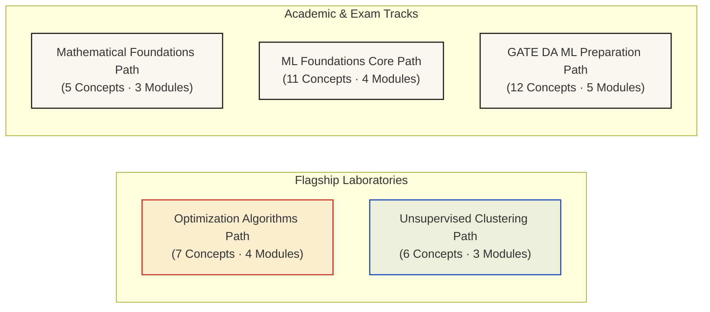
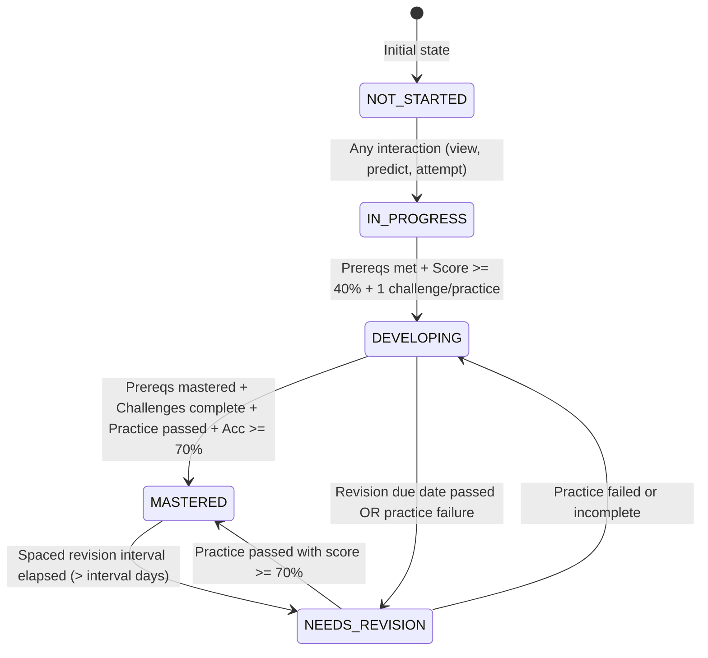

# Learning Paths & Concept Mastery Engine Architecture

**Phase:** Phase 07 — Structured Learning Paths & Concept Mastery  
**Status:** IMPLEMENTED & AUDITED  
**Date:** November 2026  
**Implementation Modules:**  
- Paths Engine: [`src/lib/learning/paths/`](file:///d:/Projects/ML%20in%20Motion/src/lib/learning/paths/)
- Mastery Engine: [`src/lib/learning/mastery/`](file:///d:/Projects/ML%20in%20Motion/src/lib/learning/mastery/)
- Assessment Bank: [`src/lib/learning/assessment/`](file:///d:/Projects/ML%20in%20Motion/src/lib/learning/assessment/)
- Spaced Revision Planner: [`src/lib/learning/revision/`](file:///d:/Projects/ML%20in%20Motion/src/lib/learning/revision/)
- Local Storage Layer: [`src/lib/learning/storage.ts`](file:///d:/Projects/ML%20in%20Motion/src/lib/learning/storage.ts)
- Dashboard UI: [`src/components/dashboard/LearningDashboard.tsx`](file:///d:/Projects/ML%20in%20Motion/src/components/dashboard/LearningDashboard.tsx)
- Practice Modal: [`src/components/dashboard/PracticeModal.tsx`](file:///d:/Projects/ML%20in%20Motion/src/components/dashboard/PracticeModal.tsx)
**Associated Automated Tests:** 17/17 Passing ([`scripts/test-phase-07-mastery.mjs`](file:///d:/Projects/ML%20in%20Motion/scripts/test-phase-07-mastery.mjs)) | Overall Suite: 96/96 Passing

---

## 1. Architectural Overview & Design Philosophy

The **Concept Mastery Engine** elevates ML in Motion from an interactive visualization sandbox into a rigorous, explainable, self-paced mathematical learning platform.

### Core Architectural Invariants
1. **Explainable Mastery (No Black-Box Scores):** Mastery is never an opaque single number or an unearned animation. Every mastery state transition is derived from verifiable student actions: reproducible Break-the-Algorithm stress tests, interactive prediction checkpoints, and analytical practice questions.
2. **Strict Prerequisite Integrity:** Concepts exist as vertices in a Directed Acyclic Graph ($G=(V, E)$). A learner cannot claim mastery of an advanced concept ($v$) if any prerequisite ancestor ($u \prec v$) remains incomplete or unverified.
3. **Bypass Exclusion Guarantee:** While learners may bypass prediction checkpoints for visual exploration, bypassed checkpoints are explicitly excluded from prediction counts and accuracy denominators. Mastery cannot be unlocked through bypasses.
4. **Local-First & Zero-Cloud Privacy:** All learner state—including mastery levels, practice question attempts, and spaced revision queues—is persisted exclusively within the user's browser `localStorage` (`ml_in_motion_learning_profile_v1`). Zero telemetry, zero accounts, and zero cloud API dependencies.

---

## 2. Structured Learning Paths

ML in Motion organizes its 20 discrete concept nodes into 5 goal-oriented learning paths:



### 2.1 Curated Path Catalog

| Path ID | Title | Modules | Total Concepts | Primary Audience / Purpose |
| :--- | :--- | :--- | :--- | :--- |
| `path-optimization` | **Optimization Algorithms (Flagship)** | 4 | 7 | Deep dive into gradient dynamics, spectral stability ($2/\lambda_{\max}$), limit cycles, anisotropic valleys, saddle points, and momentum/Adam. |
| `path-clustering` | **Unsupervised Clustering (Flagship)** | 3 | 6 | Rigorous exploration of Voronoi tessellations, Lloyd's coordinate descent, WCSS monotonicity, $D^2$ seeding guarantees, and model complexity. |
| `path-math-foundations` | **Mathematical Foundations for ML** | 3 | 5 | Pure calculus and linear algebra grounding: functions, single-variable derivatives, gradients ($\nabla J$), and Hessian curvature ($H$). |
| `path-ml-core` | **Machine Learning Foundations Core** | 4 | 11 | Complete integrated curriculum spanning calculus prerequisites, optimization dynamics, and clustering algorithms. |
| `path-gate-da` | **GATE DA Machine Learning Preparation** | 5 | 12 | Exam-focused syllabus covering analytical derivations, numerical limits, eigenvalue stability bounds, and algorithm failure modes. |

---

## 3. Concept Mastery State Machine

Every concept for a given learner resides in one of five well-defined states:



### 3.1 Explainable Mastery Scoring Formula

For any concept $c$, the continuous composite mastery score $S(c) \in [0, 100]$ is computed as:

$$S(c) = 0.40 \cdot C(c) + 0.35 \cdot P(c) + 0.25 \cdot A(c)$$

Where:
1. **Challenge Completion Fraction $C(c)$:**
   $$C(c) = \min\left(1.0, \, \frac{|\text{Completed Challenges}(c)|}{\max(1, |\text{Required Challenges}(c)|)}\right) \times 100$$
2. **Prediction Accuracy $P(c)$:**
   $$P(c) = \begin{cases} 
   0 & \text{if } N_{\text{correct}} + N_{\text{incorrect}} = 0 \\
   \frac{N_{\text{correct}}}{N_{\text{correct}} + N_{\text{incorrect}}} \times 100 & \text{otherwise}
   \end{cases}$$
   *(Note: Bypasses $N_{\text{bypass}}$ are strictly excluded from the denominator.)*
3. **Practice Assessment Pass Rate $A(c)$:**
   $$A(c) = \min\left(1.0, \, \frac{|\text{Passed Practice Questions}(c)|}{\max(1, \text{Required Practice}(c))}\right) \times 100$$

### 3.2 Transition Criteria Matrix

| Target State | Prerequisite Condition | Challenge Condition | Prediction Condition | Practice Condition | Overall Score |
| :--- | :--- | :--- | :--- | :--- | :--- |
| **`NOT_STARTED`** | Any | None | 0 attempts | 0 passed | $0\%$ |
| **`IN_PROGRESS`** | Any | Initiated $\ge 1$ | Initiated $\ge 1$ | Initiated $\ge 1$ | $> 0\%$ |
| **`DEVELOPING`** | All prereqs $\ge$ `IN_PROGRESS` | Completed $\ge 1$ | Valid predictions $\ge 1$ | Passed $\ge 1$ | $\ge 40\%$ |
| **`NEEDS_REVISION`** | Any | Any | Any | Last practice failed OR interval elapsed | $< 70\%$ or expired |
| **`MASTERED`** | **All prereqs = `MASTERED`** | **$100\%$ required challenges** | **Accuracy $\ge 70\%$ ($\ge \min$ predictions)** | **$100\%$ required practice** | **$\ge 75\%$** |

---

## 4. Assessment & Practice Bank Engine

The practice engine provides 13 mathematically verified questions testing analytical problem solving and numerical precision:

### Curated Assessment Questions
1. **`q-opt-lr-limit-cycle`:** Identifies the behavior of $J(\theta) = \frac{1}{2}(\theta - 3.5)^2 + 1$ under $\alpha = 2.0$ (conservative 2-cycle oscillation between $\theta_0$ and $7-\theta_0$, without decay or divergence).
2. **`q-opt-2d-spectral-bound`:** Computes the analytical stability threshold $\alpha_{\text{crit}} = 2/\lambda_{\max} = 2/10 = 0.20$ for an anisotropic Hessian $\text{diag}(1, 10)$.
3. **`q-opt-saddle-gradient`:** Tests understanding of zero-gradient stationary points ($\nabla J = \mathbf{0}$) with indefinite Hessian eigenvalues ($\lambda_1 < 0 < \lambda_2$).
4. **`q-opt-adam-scale`:** Explains why Adam scales updates by $\sqrt{\hat{v}_t} + \varepsilon$, dampening steep oscillations while accelerating along flat plateaus.
5. **`q-clust-wcss-descent`:** Derives why Selim-Ismail (1984) coordinate descent guarantees non-increasing WCSS ($J^{(t+1)} \le J^{(t)}$) at every Voronoi partitioning and centroid update step.
6. **`q-clust-kpp-seeding`:** Calculates the exact probability $D(x)^2 / \sum D(x')^2$ for selecting diverse cluster seeds in K-Means++.
7. **`q-math-hessian-condition`:** Evaluates the condition number $\kappa = \lambda_{\max}/\lambda_{\min}$ of anisotropic quadratic loss functions.
8. **`q-opt-1d-deadbeat`:** Demonstrates deadbeat convergence in exactly 1 step when $\alpha = 1.0$ on a quadratic bowl with $H = 1.0$.
9. **`q-opt-momentum-damping`:** Contrasts heavy-ball momentum inertia with gradient descent in oscillatory ravines.
10. **`q-clust-empty-cluster`:** Explains deterministic fallback handling when a Voronoi partition assigns zero points to a centroid.
11. **`q-clust-choosing-k`:** Clarifies why minimum WCSS alone is inadequate without penalizing model complexity ($K$).
12. **`q-math-gradient-orthogonality`:** Derives the geometric property that $\nabla J(\mathbf{x})$ is perpendicular to the tangent of the level contour $J(\mathbf{x}) = c$.
13. **`q-opt-nonconvex-restarts`:** Distinguishes random restarts and momentum exploration from mathematical guarantees of global optimality in non-convex landscapes.

### Pure Evaluation API
Evaluations are completely deterministic and side-effect free:
```typescript
export function evaluatePracticeQuestion(
  question: PracticeQuestion,
  answer: string | number
): PracticeEvaluationResult;
```
It returns detailed analytical feedback, common misconceptions, and the complete mathematical derivation.

---

## 5. Spaced Revision Planner

To ensure sustained retention, the mastery engine integrates a Leitner-inspired deterministic spaced repetition scheduler:

### 5.1 Interval Ladder
When a learner successfully passes an assessment or challenge for a concept, their revision interval increases exponentially along the ladder:
$$\Delta t \in \{1\text{ day}, \, 2\text{ days}, \, 5\text{ days}, \, 12\text{ days}, \, 30\text{ days}\}$$

- **Success:** Advancement to the next step index: $\text{step}_{k+1} = \min(\text{step}_k + 1, 4)$. Next review date = $\text{now} + \Delta t_{\text{step}}$.
- **Failure:** Immediate regression to index 0: $\text{step}_{k+1} = 0$ ($\Delta t = 1\text{ day}$). Next review date = $\text{now} + 1\text{ day}$. Mastery state regresses to `NEEDS_REVISION`.

### 5.2 Priority Urgency Scoring
Concepts in the learner's active path are ranked by urgency score $U(c)$:
$$U(c) = \begin{cases}
100 + \min(50, \text{overdueDays} \times 10) & \text{if overdue} \\
\max(0, 50 - \text{daysUntilReview} \times 10) & \text{if upcoming}
\end{cases}$$

This ensures that overdue items immediately populate the "Spaced Retention Review" queue on the dashboard.

---

## 6. Verification & Automated Test Coverage

The entire architecture is verified by automated test suites running in Node ESM environments:
- [`scripts/test-phase-07-mastery.mjs`](file:///d:/Projects/ML%20in%20Motion/scripts/test-phase-07-mastery.mjs):
  - **DAG Validation:** 20 nodes, 0 cycles, valid topological sort, correct transitive prerequisites.
  - **Path Integrity:** 5 paths, non-empty modules, all referenced concept IDs exist in the DAG.
  - **Assessment Engine:** Evaluator correctness, multiple-choice checking, numerical tolerance checking, feedback derivations.
  - **Mastery State Machine:** State transitions, prerequisite lockouts, bypass exclusion, explainable scoring weights.
  - **Spaced Revision Planner:** Interval advancement, failure reset, queue sorting, urgency ordering.
  - **Edge Cases:** Circular graph rejection, missing concept error handling, empty profile resilience.
- **Combined Platform Regression:** 96/96 passing across all test suites.
- **Production Build:** Next.js 14.2.35 compilation successful with zero errors.
