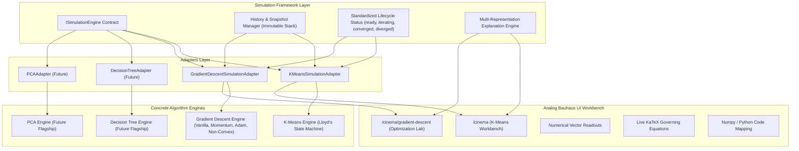
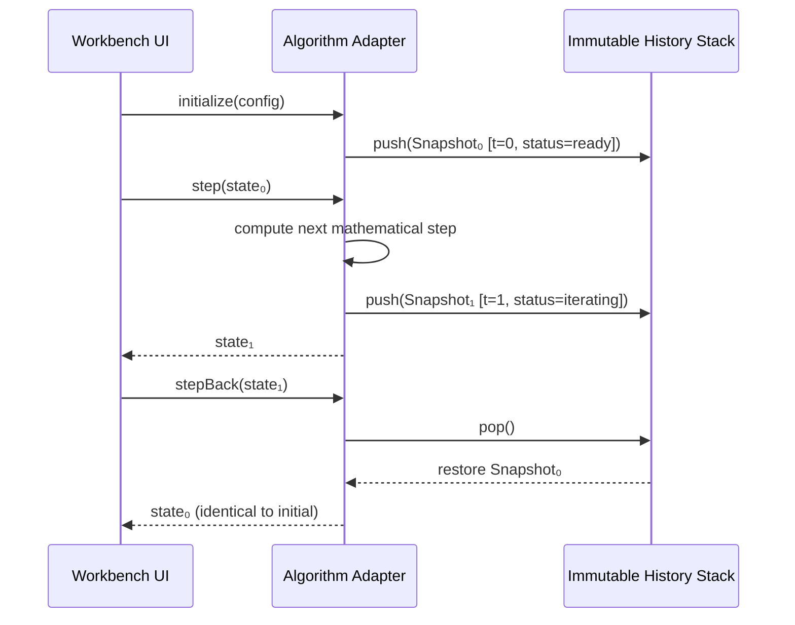

# Shared Algorithm Simulation Framework Architecture (Phase 04)

**Platform:** *ML in Motion* (`https://mlinmotion.vercel.app`)  
**Status:** Production Standard  
**Package:** `src/lib/simulation/framework`

---

## 1. Executive Architecture Overview

The **Shared Algorithm Simulation Framework** establishes a unified, deterministic, and mathematically reversible simulation substrate across distinct families of machine learning algorithms on *ML in Motion*.

Rather than forcing fundamentally different mathematical algorithms into an awkward monolithic engine, the architecture establishes a **strict common contract** (`ISimulationEngine`), **immutable snapshot management** (`appendSnapshot`, `popHistoricalSnapshot`), and **standardized lifecycle transitions** (`SimulationLifecycleStatus`), connecting disparate algorithm engines through zero-overhead adapters.



---

## 2. Core Principles & Invariants

1. **Zero Framework Coupling to React/DOM:**  
   The simulation core, history manager, and algorithm adapters have zero dependencies on React, Next.js, Web APIs (`window`, `document`), or UI components. They are 100% executable and testable in pure headless Node.js/CLI environments.
2. **First-Principles Parity & Determinism:**  
   No synthetic animations or estimated trajectories. Given the exact same configuration, initial points, and seed, the simulation engine produces bit-for-bit identical parameter vectors, WCSS metrics, and loss values.
3. **Lossless Bidirectional Reversibility:**  
   `stepBack()` does not approximate earlier states: it pops from an immutable `historyStack` and completely restores the preceding state, including hidden internal tensors (e.g., Polyak momentum velocity $v_t$, Adam moments $m_t, v_t, t$, and K-Means cluster assignments).
4. **Deep Instance Isolation:**  
   Separate instances of the same adapter do not share mutable state. Stepping instance A has zero side-effects on instance B.
5. **No Universal Superiority ("No Free Lunch"):**  
   The framework strictly avoids misleading claims. Multi-optimizer comparisons expose computational complexity (Flops, auxiliary memory) and trade-offs alongside raw iteration counts.

---

## 3. Generic Interface Definitions

### 3.1 Lifecycle Status Taxonomy
```typescript
export type SimulationLifecycleStatus =
  | 'uninitialized'
  | 'ready'
  | 'iterating'
  | 'converged'
  | 'diverged'
  | 'max_iterations_reached'
  | 'stationary'
  | 'limit_cycle'
  | 'error';

export type AlgorithmFamily =
  | 'clustering'
  | 'optimization'
  | 'dimensionality-reduction'
  | 'tree'
  | 'linear-model';
```

### 3.2 Generic Engine Contract
```typescript
export interface ISimulationEngine<
  TConfig,
  TState extends BaseSimulationState<TConfig, TSnapshot>,
  TSnapshot extends BaseSimulationSnapshot,
  TMetrics = unknown,
  TInitArgs = unknown
> {
  readonly algorithmId: string;
  readonly algorithmName: string;
  readonly algorithmFamily: AlgorithmFamily;

  initialize(config: TConfig, initArgs?: TInitArgs): TState;
  step(state: TState): TState;
  stepBack(state: TState): TState;
  run(state: TState, maxSteps?: number): TState;
  reset(state: TState, newConfig?: Partial<TConfig>): TState;
  getMetrics(state: TState): TMetrics;
  getExplanation(state: TState): SimulationExplanation;
  getStatus(state: TState): SimulationLifecycleStatus;
  exportExperiment(state: TState): SavedExperimentRecord;
}
```

### 3.3 State & Snapshot Model
```typescript
export interface BaseSimulationSnapshot {
  stepNumber: number;
  iteration: number;
  status: SimulationLifecycleStatus;
  isConverged: boolean;
  isDiverged: boolean;
  stopReason?: string;
}

export interface BaseSimulationState<TConfig, TSnapshot extends BaseSimulationSnapshot> {
  config: Readonly<TConfig>;
  stepNumber: number;
  iteration: number;
  status: SimulationLifecycleStatus;
  isConverged: boolean;
  isDiverged: boolean;
  stopReason?: string;
  historyStack: ReadonlyArray<Readonly<TSnapshot>>;
}
```

---

## 4. History Stack & Reversibility Mechanics

Historical navigation is governed by `src/lib/simulation/framework/history.ts`.



- **Snapshot Immutability:** `appendSnapshot` clones every new state snapshot using structured cloning to ensure that subsequent parameter mutations cannot contaminate past history.
- **Root Protection:** `popHistoricalSnapshot` will never pop below the root snapshot ($t = 0$). At step 0, `stepBack` is a safe no-op that preserves the initial state.

---

## 5. Existing Algorithm Integrations

### 5.1 K-Means Clustering (`KMeansSimulationAdapter`)
- **Family:** `'clustering'`
- **Algorithm:** Lloyd's alternating minimization ($E$-step Voronoi assignment, $M$-step Center of Mass update).
- **Scale Invariance:** Convergence is evaluated via relative centroid shift over dataset bounding diagonal:
  $$\frac{\Delta \mu}{\text{coordSpan}} < 10^{-4}$$
  with fallback underflow safeguard $\Delta \mu < 10^{-7}$ and zero-span handling.
- **Reversibility:** Restores points cluster labels, previous clusters, centroid positions, and history trails.

### 5.2 Gradient Descent (`GradientDescentSimulationAdapter`)
- **Family:** `'optimization'`
- **Supported Optimizers:** Vanilla GD, Polyak Heavy-Ball Momentum ($\gamma = 0.9$), Adam ($\beta_1 = 0.9, \beta_2 = 0.999, \varepsilon = 10^{-8}$).
- **Supported Landscapes:** 1D Quadratic, 2D Isotropic Bowl ($\kappa = 1$), 2D Anisotropic Valley ($\kappa = 10$), Rosenbrock Banana Valley (Non-Convex), Hyperbolic Saddle Point, Rastrigin Multimodal Surface.
- **Reversibility:** Restores optimizer state tensors ($v_t$ for Momentum; $m_t, v_t, t$ for Adam) alongside parameter coordinates $\boldsymbol{\theta}_t$.

---

## 6. How to Add a Future Algorithm (e.g., Decision Tree or PCA)

To add a new algorithm flagship (such as Decision Trees or Principal Component Analysis):

1. **Implement the Mathematical Engine:**  
   Write a headless engine module in `src/lib/simulation/yourAlgorithmEngine.ts`. Focus exclusively on the mathematical recurrence, purity, and analytical precision.
2. **Define Typed Snapshots & Config:**  
   Ensure your snapshot extends `BaseSimulationSnapshot` by providing `stepNumber`, `iteration`, `status`, `isConverged`, and `isDiverged`.
3. **Implement `ISimulationEngine` Adapter:**  
   Create `src/lib/simulation/adapters/yourAlgorithmAdapter.ts`:
   ```typescript
   export class DecisionTreeAdapter implements ISimulationEngine<
     DecisionTreeConfig,
     AdaptedDecisionTreeState,
     AdaptedDecisionTreeSnapshot,
     DecisionTreeMetrics,
     { dataset: FeatureMatrix; labels: number[] }
   > {
     readonly algorithmId = 'decision-tree';
     readonly algorithmName = 'CART Decision Tree Classifier';
     readonly algorithmFamily = 'tree';

     initialize(config, initArgs) { /* ... */ }
     step(state) { /* split best node by Gini / entropy */ }
     stepBack(state) { /* prune back to parent node */ }
     run(state, maxSteps) { /* ... */ }
     reset(state) { /* ... */ }
     getMetrics(state) { /* depth, leaf count, impurity */ }
     getExplanation(state) { /* split criterion formula */ }
     getStatus(state) { /* ready | iterating | converged */ }
     exportExperiment(state) { /* ... */ }
   }
   ```
4. **Register in `src/lib/simulation/framework/index.ts`:**  
   Export the adapter and its types.
5. **Add Contract Tests in `scripts/test-simulation-framework.mjs`:**  
   Test initialization, forward stepping, reverse stepping, and instance isolation.
6. **Mount in UI Workbench:**  
   Build the Analog Bauhaus workbench using the standardized controls and telemetry cards.
